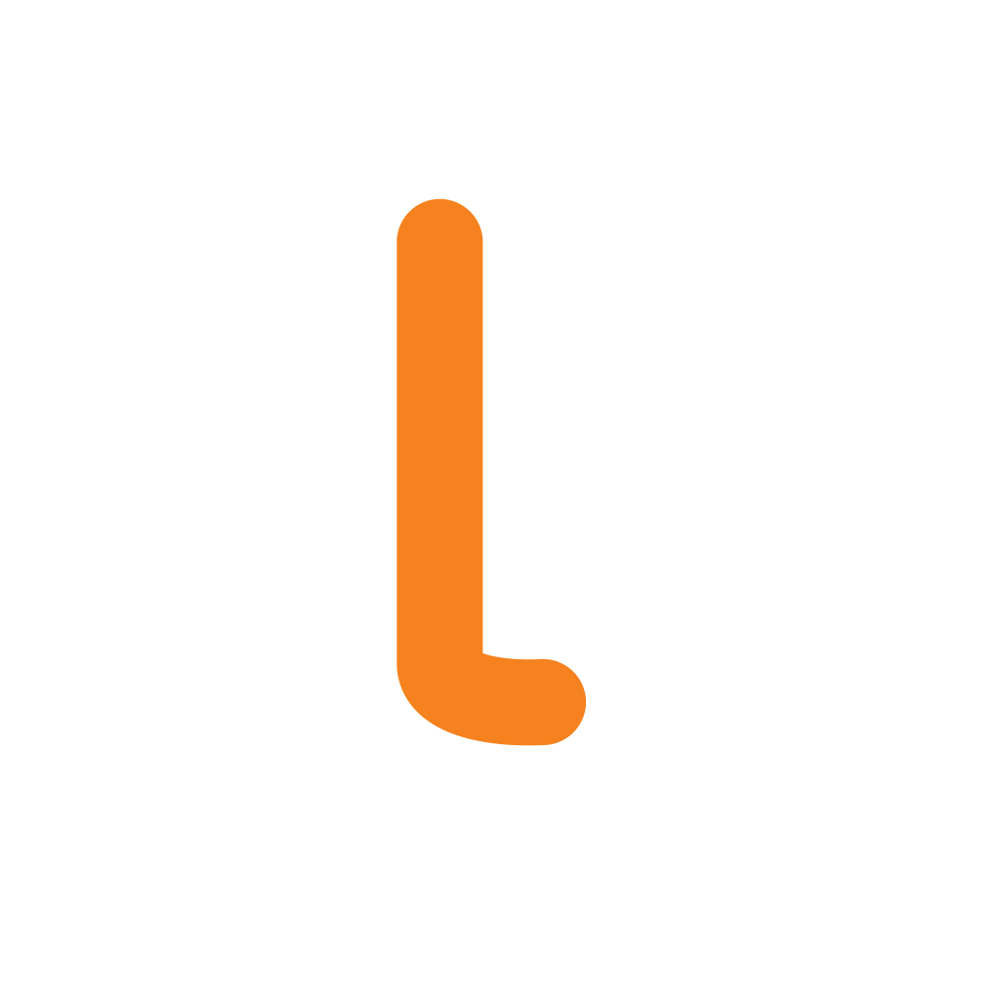
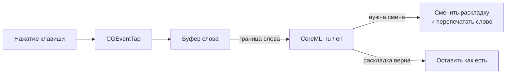

<div align="center">



# linotype

**Умный переключатель раскладки ru/en для macOS.**
Локально, на нейросети CoreML. Без интернета и без слежки.

</div>

---

linotype исправляет раскладку на лету: набрали `ghbdtn` вместо `привет` — слово
мгновенно перепечатывается в правильной раскладке. Решение принимает компактная
нейросеть прямо на устройстве (точность ≈99.9% на тестовой выборке), а не список
правил. Всё работает офлайн; нажатия никуда не отправляются и не сохраняются.

## Возможности

- **Автопереключение** раскладки по нейросети (on-device CoreML).
- **Ручное переключение** последнего слова — двойной Shift, двойной Option или одиночный Option (настраивается).
- **⌘⌥L** — перекодировать выделенный текст в противоположную раскладку.
- **⌘⌥'** — заменить прямые кавычки в выделении на парные «ёлочки».
- **Ёфикация** — расстановка ё в однозначных словах (опционально).
- **Умные тире** — `5-10` → `5–10`, ` - ` → ` — ` (опционально).
- **Плашка РУ/EN** под иконкой в меню-баре при переключении.
- **Исключения** — список приложений (терминалы и IDE уже исключены) и слов.
- **Тихо** рядом с приложениями звуков клавиш (Klack и др.) — события вставляются так, что они не пищат на автозамене.

## Приватность

- Никаких сетевых запросов — ни при работе, ни при установке.
- Нажатия не логируются и не покидают устройство; модель работает локально.
- В полях паролей (secure input) перехват отключается автоматически.

## Как это работает



Перехват — через `CGEventTap`, смена раскладки — через `TISInputSource`, замена
текста — синтетическими `CGEvent` (без буфера обмена). Классификатор — символьные
n-граммы + логистическая регрессия, экспортированные в CoreML.

## Сборка

Требования: **macOS 13+**, Xcode (SDK macOS 26). Универсальная сборка (Apple Silicon + Intel).

```bash
git clone <repo-url>
cd linotype
open linotype.xcodeproj   # затем ⌘R
```

Или из терминала:

```bash
xcodebuild -project linotype.xcodeproj -scheme linotype -configuration Release build
```

При первом запуске macOS попросит доступ в **Системные настройки →
Конфиденциальность и безопасность → Универсальный доступ** — он нужен для
перехвата клавиш. Иконка появляется в меню-баре (значка в Dock нет).

## Модель (для разработчиков)

Скрипты в `scripts/` переобучают и проверяют классификатор:

```bash
python train_model.py     # обучение + экспорт в CoreML (LinotypeModel.mlmodel, vocab.json)
python test_cases.py      # лингвистические автотесты
python build_yo_dict.py   # пересборка словаря ёфикации
```

## Лицензия

MIT. Словарь ёфикации основан на [eyo-kernel](https://github.com/e2yo/eyo-kernel).
